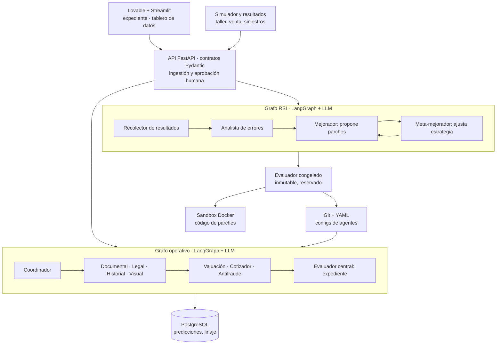
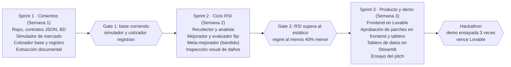

# KAVAK AUTOGUARD AI — Plan de trabajo

9 de noviembre de 2026 · Dylan

## Resumen

Construiremos en 3 sprints de una semana un MVP que verifica un auto seminuevo, cotiza su póliza y demuestra en vivo que su error de cotización baja solo, gracias a un ciclo de auto-mejora recursiva (RSI).

### La problemática en México

- **7 de cada 10 vehículos circulan sin seguro.** De 58.2 millones de vehículos registrados (INEGI, 2023), la AMIS estima que solo 30% tiene póliza. [Animal Político, jul 2026](https://grupoanimal.mx/hablemos-de/mexico-mas-vehiculos-pocos-seguros-qualitas-record)
- **El precio expulsa a la gente.** Al terminar el crédito automotriz, muchos dueños no renuevan la póliza o reducen coberturas para abaratarla. [Animal Político, jul 2026](https://grupoanimal.mx/hablemos-de/mexico-mas-vehiculos-pocos-seguros-qualitas-record)
- **El riesgo es alto y real.** Entre julio de 2025 y junio de 2026 se robaron 50,891 autos asegurados, cerca de 139 por día, y entre enero y noviembre de 2025 hubo 566,820 colisiones con autos asegurados. [Animal Político, jul 2026](https://grupoanimal.mx/hablemos-de/mexico-mas-vehiculos-pocos-seguros-qualitas-record)
- **El fraude crece.** La AMIS reporta un alza de 5% a 10% en "montachoques" en el primer semestre de 2026, y los delincuentes buscan autos sin seguro. [Expansión, jul 2026](https://expansion.mx/economia/2026/07/15/suben-10-los-montachoques-en-2026-y-aseguradoras-piden-tipificar-el-delito-en-todo-el-pais)
- **El seminuevo es una caja negra.** Historial, siniestros y procedencia están dispersos; quien compra o asegura paga la incertidumbre con un sobreprecio.

**Nuestra tesis:** si la prima refleja el riesgo real de cada auto y mejora con cada póliza, baja para los autos de bajo riesgo y más mexicanos pueden asegurarse.

### Supuestos de este plan

- Equipo de 4 a 5 personas trabajando con Scrum.
- El hackathon ocurre al final del sprint 3; si la fecha es otra, los sprints se recorren.
- Todos los datos de la demo son simulados y se etiquetan como tales.

## PRD: requisitos de producto

El producto entrega, por cada auto, un expediente con valuación, cotización de póliza y alertas, y un tablero que prueba que el sistema aprende de sus errores.

### Objetivos

1. Cotizar primas justas: que el error entre prima y costo real converja hacia cero conforme se venden pólizas.
2. Reducir el riesgo de compra: detectar inconsistencias documentales, legales y daños antes de comprar.
3. Demostrar RSI verificable: mostrar que el sistema mejora solo y que su forma de mejorar también mejora.

### Usuarios

| Usuario | Necesidad | Qué usa |
| --- | --- | --- |
| Valuador de Kavak | Decidir si compra un auto y a qué precio | Expediente digital |
| Cliente comprador | Asegurar su auto a un precio justo | Cotización explicada |
| Actuario o analista de riesgo | Validar que los ajustes de tarifa sean sólidos | Bitácora de parches y aprobación |
| Ajustador | Dictaminar un siniestro rápido y sin fraude | Dictamen preliminar |
| Jueces del hackathon | Ver el RSI funcionando | Tablero de curvas de aprendizaje |

### Historias de usuario del MVP

1. Como valuador, subo factura, tarjeta y fotos, y recibo un perfil JSON del auto con discrepancias marcadas.
2. Como valuador, veo los daños detectados en fotos con su costo estimado de reacondicionamiento.
3. Como cliente, recibo una prima con los factores que la explican y su nivel de confianza.
4. Como actuario, veo cada parche propuesto con métricas antes y después, y lo apruebo o rechazo.
5. Como juez, veo en vivo tres cotizadores (estático, ajuste de parámetros, RSI completo) y el área de error de cada uno.
6. Como analista, regreso a cualquier versión anterior del cotizador en un clic.

### Requisitos funcionales

| ID | Requisito | Prioridad |
| --- | --- | --- |
| RF-01 | Extraer VIN, placas, marca, modelo, año y vigencias de documentos | MVP |
| RF-02 | Comparar datos entre documentos con reglas determinísticas | MVP |
| RF-03 | Detectar daños visibles en fotos y estimar su costo | MVP |
| RF-04 | Generar el perfil JSON del vehículo | MVP |
| RF-05 | Cotizar prima con factores explicables e intervalo de confianza | MVP |
| RF-06 | Registrar cada predicción con la versión del agente | MVP |
| RF-07 | Simular mercado: ventas, siniestros y función de riesgo oculta | MVP |
| RF-08 | Calcular error, regret acumulado y pólizas a convergencia | MVP |
| RF-09 | Analizar errores por segmento y proponer parches | MVP |
| RF-10 | Evaluar parches en un conjunto reservado con pruebas de regresión | MVP |
| RF-11 | Meta-mejorador que ajusta la estrategia de propuesta | MVP |
| RF-12 | Tablero de datos en Streamlit con curvas, linaje de versiones y bitácora | MVP |
| RF-13 | Valuación con comparables de mercado | Deseable |
| RF-14 | Consultas a REPUVE y validación de CFDI | Deseable |
| RF-15 | Dictamen preliminar de siniestros | Fase 2 |
| RF-16 | Reporte de siniestro por voz | Fase 2 |

### Requisitos no funcionales

- **Trazabilidad:** toda predicción y todo parche son auditables y revertibles.
- **Seguridad del RSI:** el evaluador, el conjunto reservado y la función objetivo están fuera del alcance del mejorador.
- **Explicabilidad:** ninguna prima sale sin sus factores.
- **Equidad:** solo variables permitidas; nada de género, edad u otros atributos sensibles.
- **Privacidad:** el ciclo RSI trabaja con datos anonimizados.
- **Desempeño:** expediente en menos de 2 minutos; una generación RSI del simulador en menos de 1 minuto para que quepa en la demo.

### Fuera de alcance del MVP

- Tarifas reales o emisión de pólizas.
- Integraciones con aseguradoras o bases privadas.
- Cualquier despliegue: el MVP y la demo corren en local.

### Métricas de éxito del MVP

| Métrica | Meta en la demo |
| --- | --- |
| Regret acumulado del RSI completo frente al estático | Al menos 40% menor |
| Pólizas hasta convergencia | Menos que la versión de solo parámetros |
| Tasa de aceptación de parches | Sube entre la primera y la última generación |
| Precisión de extracción documental | 90% o más en el set de prueba |
| Recall de daños en fotos | 80% o más en el set de prueba |

Las metas son objetivos de diseño para la demo simulada, no resultados medidos.

## TRD: requisitos técnicos

El backend es un servicio Python con dos grafos de agentes (operativo y RSI) que comparten una base de datos de predicciones y un repositorio versionado de configuraciones de agentes.

### Principios de diseño

1. **El LLM propone, el código certifica.** Comparar VIN, calcular primas, medir errores y evaluar parches es código determinístico.
2. **Todo agente es configuración versionada.** Factores, prompts y reglas viven en archivos YAML dentro de Git; un parche es un commit.
3. **Toda predicción se registra** con la versión exacta del agente que la produjo.
4. **El evaluador es inmutable** para los agentes: vive en otro módulo, sin permisos de escritura desde el grafo RSI.

### Contrato: perfil del vehículo

```json
{
  "id": "ID2",
  "marca": "Volkswagen",
  "modelo": "Sedan",
  "anio": 1985,
  "kilometraje": 210000,
  "siniestros_previos": 1,
  "uso": "particular",
  "zona": "CDMX",
  "danos": [{"zona": "defensa_trasera", "tipo": "reparacion", "costo_est": 3500, "confianza": 0.72}],
  "alertas": [],
  "cobertura_verificacion": 0.85
}
```

### Contrato: predicción registrada

```json
{
  "prediction_id": "pred_000123",
  "vehicle_id": "ID2",
  "agent": "cotizador",
  "agent_version": "cotizador@a1f9c2e",
  "output": {"prima": 1350, "intervalo": [1180, 1520], "factores": {"siniestro_previo": 1.12, "antiguedad": 1.05}},
  "created_at": "2026-11-20T18:30:00Z"
}
```

### Contrato: parche propuesto

```json
{
  "patch_id": "patch_017",
  "generation": 3,
  "agent": "cotizador",
  "nivel": "parametros",
  "hipotesis": "Sobrecotiza autos de mas de 30 anios con 1 siniestro previo",
  "segmento": {"anio_max": 1996, "siniestros_previos": 1},
  "diff": "factores.siniestro_previo.antiguo: 1.12 -> 1.04",
  "metrica_objetivo": "loss_asimetrica",
  "veredicto": null
}
```

### Modelo de datos (PostgreSQL)

| Tabla | Campos clave | Para qué sirve |
| --- | --- | --- |
| vehicles | id, perfil_json, created_at | Perfil consolidado de cada auto |
| documents | id, vehicle_id, tipo, storage_url, extracted_json | Documentos y lo extraído |
| predictions | id, vehicle_id, agent, agent_version, input_hash, output_json | Registro de predicciones |
| outcomes | id, prediction_id, fuente, valor_json, observed_at | Resultado real: taller, venta, siniestro o simulador |
| errors | prediction_id, metrica, valor, segmento | Error calculado por predicción |
| agent_versions | id, agent, parent_id, git_sha, estado, metrics_json | Linaje: campeón, retador, sombra, retirado |
| patches | id, generation, agent, nivel, hipotesis, diff, veredicto, metrics_before, metrics_after | Bitácora de mejoras |
| meta_strategy | generation, estrategia_json, tasa_aceptacion, ganancia_media | Historial del meta-mejorador |

### Función objetivo

La pérdida por póliza es asimétrica: cobrar de menos cuesta más que cobrar de más.

$$
L(p, c) = \alpha \max(0,\ c - p) + \beta \max(0,\ p - c), \quad \alpha > \beta
$$

La métrica principal es el regret acumulado, el área bajo la curva de error contra pólizas vendidas:

$$
R(N) = \sum_{i=1}^{N} L(p_i, c_i)
$$

α y β se fijan antes de empezar (propuesta: α = 1.5, β = 1.0) y el sistema no puede cambiarlos.

### Simulador de mercado

- **Población:** autos sintéticos con marca, año, km, siniestros previos, uso, zona y daños.
- **Riesgo oculto:** costo real = base × factores por variable × ruido lognormal; los factores reales nunca se exponen a los agentes.
- **Demanda:** cada cliente tiene una disposición a pagar alrededor del costo esperado; compra si la prima está por debajo.
- **Siniestros:** se muestrean por póliza vendida con la función oculta.
- **Semilla fija:** las tres versiones del cotizador ven la misma secuencia de autos para que la comparación sea justa.

### Ciclo RSI, paso a paso

1. El simulador entrega un lote de autos; el cotizador campeón cotiza y se registran las predicciones.
2. Se resuelven ventas y siniestros; el recolector escribe outcomes y errors.
3. Cada K lotes, el analista agrupa errores por segmento con pandas, calcula sesgo medio y su significancia, y entrega las 3 hipótesis de mayor impacto.
4. El mejorador (LLM) genera hasta 3 parches siguiendo la estrategia vigente.
5. El evaluador reproduce cada retador sobre el conjunto reservado (20% de casos cerrados que el mejorador nunca ve).
6. Se acepta si baja la pérdida al menos δ, ningún segmento empeora más de ε y pasa el chequeo de variables permitidas.
7. En el simulador, el retador aceptado se vuelve campeón; en producción iría a modo sombra y a aprobación humana.
8. El meta-mejorador actualiza su estrategia y el ciclo vuelve al paso 1.

### Cómo funciona el meta-mejorador

- Trata cada tipo de parche (ajuste de factor, nueva variable, cambio de regla, cambio de prompt) como un brazo de un **bandido multibrazo con Thompson sampling**; la recompensa es la ganancia en el conjunto reservado.
- Cada generación resume en lenguaje natural las lecciones de parches aceptados y rechazados, y reescribe la sección de estrategia del prompt del mejorador.
- Ese cambio de estrategia también se evalúa: si la ganancia media de la generación siguiente baja, se revierte.

### Seguridad técnica

- El código generado en parches de nivel 3 corre en un contenedor sin red, con límite de CPU, memoria y tiempo.
- Lista blanca de variables para cotizar, validada por el evaluador en cada parche.
- Llaves de API solo en variables de entorno del backend; nunca en el frontend ni en texto plano.
- Fotos y documentos en almacenamiento privado con URLs firmadas.

## Diagrama de backend

Los resultados reales mejoran a los agentes solo si pasa el evaluador.



El grafo operativo registra cada predicción en PostgreSQL; el grafo RSI compara contra resultados reales y manda parches al evaluador congelado, que los prueba en el sandbox. Solo un parche aceptado se vuelve commit en Git, y de ahí lo carga el grafo operativo. Ambos grafos llaman al LLM; Tavily y Firecrawl solo los usa el agente de valuación.

## Tecnologías a implementar

El núcleo es Python con LangGraph y Streamlit para los datos. De los beneficios permitidos solo usamos los que aportan algo que el proyecto no tiene: Lovable para el frontend, Tavily y Firecrawl para la valuación y ElevenLabs para el video de respaldo. Linear, Miro y backboard.io no se usan porque duplicarían lo que ya resuelven el repo y PostgreSQL.

### Stack núcleo

| Capa | Tecnología | Uso |
| --- | --- | --- |
| API | Python 3.11 + FastAPI + Pydantic | Endpoints, validación de contratos JSON |
| Orquestación de agentes | LangGraph | Grafo operativo y grafo RSI |
| Modelo | OpenAI vía Responses API (`gpt-6.1-sol` por defecto, configurable con `LLM_MODEL`) | Extracción de documentos, daños en fotos, hipótesis y parches |
| Cálculo | pandas + numpy + scipy | Simulador, errores por segmento, significancia |
| Datos y tablero | Streamlit (gráficas nativas o Plotly) | Tablero de datos: curvas de error, área de regret, comparación de las 3 versiones, linaje y bitácora de parches; lee las corridas de `var/runs/` |
| Base de datos | SQLite local (Postgres opcional) | Registro de predicciones, outcomes, linaje |
| Archivos | Disco local (solo se guardan las extracciones) | Fotos y documentos |
| Versionado de agentes | Git (GitPython) + archivos YAML | Cada parche es un commit revertible |
| Sandbox | Docker sin red | Ejecutar código de parches de nivel 3 |
| Ejecución | Todo en local con `scripts/demo.sh` (API :8000, tablero :8501, frontend Lovable con `npm run dev`); sin despliegue | Demo reproducible sin depender de red |

### Beneficios Hacktoberfest: qué usamos y para qué

Solo se usan beneficios de la lista permitida, y únicamente los que aportan algo; ningún otro servicio de pago entra al proyecto. La ingestión de resultados, el disparo del ciclo RSI y la aprobación de parches se operan directo con la API desde el frontend y el tablero.

| Herramienta | Decisión | Uso concreto | Cuidado |
| --- | --- | --- | --- |
| Lovable Pro | Usar con presupuesto | Frontend de usuario: carga de documentos y expediente; el tablero de datos va en Streamlit | 100 créditos: un prompt inicial muy detallado, máximo unas 10 iteraciones grandes, conectar GitHub desde el inicio y hacer ajustes menores en código. Cancelar antes de la renovación |
| Linear Business | No usar | El backlog vive en `TASKS.md` y el estado en `scripts/tasks.sh` (rama `tasks-state`), que coordina a las 4 sesiones; llevarlo también en Linear sería doble captura | Ninguno |
| Miro Enterprise | No usar | Los diagramas de arquitectura y de sprints ya están en Mermaid dentro del plan y del repo; el storyboard del pitch va en `docs/demo.md` | Ninguno |
| Tavily | Usar solo en valuación | Buscar anuncios de autos comparables | Cachear resultados; presupuestar unas 300 búsquedas |
| Firecrawl | Usar solo en valuación | Convertir anuncios a precio, año y km estructurados | Respetar términos de uso de cada portal; cachear |
| ElevenLabs Creator | Usar solo para el video | Narración del video de respaldo del pitch por si falla la demo en vivo | No es parte del producto; vence a fines de noviembre |
| backboard.io | No usar | La memoria del sistema ya vive en PostgreSQL | Ninguno |

### Por qué LangGraph y sin n8n

El ciclo RSI necesita estado tipado, reintentos, ramas condicionales y ejecución rápida de cientos de lotes en la demo. Eso es más simple y barato en Python. Las integraciones (ingestión de resultados, disparo del ciclo y aprobación humana) las expone la API FastAPI y se operan desde el frontend y el tablero, sin una capa extra de automatización.

## Plan de trabajo

Tres sprints de una semana; si el Gate 2 no se cumple, el sprint 3 se recorta a frontend mínimo y todo el equipo ajusta el ciclo RSI, porque es lo que califican los jueces.



Cada gate se revisa en la retrospectiva del sprint; el avance se sigue en `TASKS.md` con `scripts/tasks.sh list`.

### Backlog por sprint

**Sprint 1: cimientos**

- [ ] Crear repo, estructura de carpetas y protocolo multi-sesión (`AGENTS.md`, `scripts/tasks.sh`)
- [ ] Definir contratos JSON con Pydantic (perfil, predicción, parche)
- [ ] Crear tablas en Supabase (vehicles, predictions, outcomes, errors, agent_versions, patches, meta_strategy)
- [ ] Simulador: población sintética, riesgo oculto, demanda y siniestros con semilla fija
- [ ] Cotizador base con factores en YAML y registro de predicciones
- [ ] Agente documental: extraer campos de 3 documentos de ejemplo
- [ ] Fijar α, β, δ y ε de la función objetivo

**Sprint 2: ciclo RSI**

- [ ] Recolector: unir predicciones con resultados y calcular pérdida
- [ ] Analista: sesgo por segmento y top 3 hipótesis
- [ ] Mejorador: generar parches como diffs de YAML
- [ ] Evaluador congelado: replay en conjunto reservado, regresión por segmento, lista blanca de variables
- [ ] Linaje en Git: cada parche aceptado es un commit, con reversión
- [ ] Meta-mejorador: Thompson sampling por tipo de parche y resumen de lecciones
- [ ] Correr las 3 versiones (estática, parámetros, RSI) y medir regret
- [ ] Agente visual: detectar daños y estimar costo en un set pequeño de fotos

**Sprint 3: producto y demo**

- [ ] Frontend en Lovable: carga y expediente (un prompt inicial detallado)
- [ ] Tablero de datos en Streamlit: curvas de error, área de regret, bitácora y botón de reversión
- [ ] Aprobación de parches desde el frontend y el tablero (vía API)
- [ ] Valuación con comparables (Tavily y Firecrawl, con caché)
- [ ] Grabar video de respaldo de la demo
- [ ] Ensayar el pitch 3 veces con cronómetro
- [ ] Cancelar Lovable Pro antes de su renovación

### Roles

| Rol | Entregables |
| --- | --- |
| Líder técnico y RSI | Grafo RSI, evaluador congelado, meta-mejorador |
| Backend y datos | API, Supabase, simulador, registro de predicciones |
| Agentes de percepción | Documental, inspección visual, valuación |
| Frontend y automatización | Lovable, tablero en Streamlit |
| Producto y pitch | PRD, modelo de negocio, guion, video de respaldo |

### Riesgos del plan

| Riesgo | Mitigación |
| --- | --- |
| El RSI no supera al ajuste simple de parámetros | Empezar por segmentos con sesgo claro en el simulador; mostrar también la mejora del meta-mejorador |
| Se agotan los créditos de Lovable | Conectar GitHub desde el primer prompt y editar en código |
| Expira Lovable antes del hackathon | Frontend en GitHub; alternativa: llevar todo el frontend a Streamlit |
| El LLM genera parches inválidos | Validar el YAML con Pydantic antes de evaluar; descartar sin consumir el conjunto reservado |
| La demo en vivo falla | Video de respaldo y semilla fija para resultados reproducibles |

## Modelo de negocio

Vendemos un motor B2B de verificación y tarificación que se vuelve más preciso con el volumen: Kavak es el primer cliente y canal, y las aseguradoras e insurtechs son el mercado grande.

| Bloque | Propuesta |
| --- | --- |
| Segmento 1 | Kavak: compra de seminuevos y venta de seguros o garantías a sus clientes |
| Segmento 2 | Aseguradoras e insurtechs que cotizan autos usados |
| Segmento 3 | Lotes de seminuevos, financieras automotrices y plataformas de subastas |
| Propuesta de valor | Primas y precios de compra que se calibran solos con cada caso cerrado, con cada ajuste explicado y auditable |
| Canal | Integración por API; piloto interno en Kavak como caso de éxito para vender a aseguradoras |
| Ingresos | Pago por expediente verificado; licencia anual del motor de tarificación más cuota por póliza cotizada; cuota de éxito sobre la mejora en siniestralidad medida |
| Costos | Tokens de LLM, infraestructura, acceso a fuentes de datos con convenio, revisión actuarial y legal |
| Recursos clave | Registro de predicciones y resultados: el historial de errores corregidos es el activo |
| Ventaja defendible | Efecto volante de datos: más pólizas, más resultados, menor error, primas más competitivas, más pólizas |
| Métricas de negocio | Expedientes por mes, pólizas cotizadas, conversión, siniestralidad por segmento, ahorro frente a la tarifa anterior |

Los precios por expediente y por póliza se definen después de entrevistar a 5 a 10 valuadores y analistas de riesgo; aún no hay cifras validadas.

### Impacto para México

- **Más autos asegurados:** si la prima baja para quien tiene bajo riesgo, se reduce la barrera que hoy deja fuera a 7 de cada 10 vehículos.
- **Menos víctimas sin respaldo:** cada póliza de responsabilidad civil protege a terceros en un choque.
- **Mercado de seminuevos más confiable:** el expediente reduce el riesgo de comprar un auto con siniestros ocultos o problemas de procedencia.
- **Menos fraude:** el dictamen compara el siniestro contra el estado registrado del auto, útil frente a montachoques y daños preexistentes.

### Riesgos de negocio

| Riesgo | Mitigación |
| --- | --- |
| Las tarifas de seguros requieren sustento actuarial ante la CNSF | El RSI propone, un actuario valida; el producto es herramienta de apoyo, no emisor |
| Acceso limitado a datos de siniestros | Arrancar con el ciclo rápido de taller y venta de Kavak; convenios después |
| Retroalimentación lenta en siniestros (meses) | Ciclos rápidos primero y simulador para validar la mecánica |
| Percepción de discriminación en precios | Lista blanca de variables, auditoría de equidad y explicación de cada prima |

## Pitch (3 minutos)

El pitch abre con el dato de los autos sin seguro, muestra la curva de aprendizaje en vivo y cierra con el impacto para México.

**1. Gancho (20 s).** "En México circulan más de 58 millones de vehículos. Siete de cada diez no tienen seguro. Si uno de ellos te choca, nadie paga."

**2. El problema (30 s).** "No es solo descuido. Mucha gente deja de renovar su póliza cuando termina de pagar el auto, porque el seguro se siente caro. Y en parte lo es: las primas se calculan con reglas fijas que cobran de más a muchos para cubrir lo que no saben de pocos. Al mismo tiempo, comprar un seminuevo es una apuesta: siniestros ocultos, papeles que no cuadran y fraudes como los montachoques, que este año crecieron hasta 10%."

**3. La solución (30 s).** "KAVAK AUTOGUARD AI revisa cada auto con un equipo de agentes: documentos, situación legal, historial y daños en fotos. Con eso dice cuánto vale, cuánto cuesta dejarlo listo y cuánto debería costar asegurarlo."

**4. El diferenciador RSI (40 s).** "Pero lo importante es lo que pasa después. El sistema compara cada cotización con lo que realmente pasó, encuentra dónde se equivoca, se propone cambios a sí mismo y solo adopta los que un evaluador independiente comprueba. Y aprende qué tipo de cambios funcionan, así que cada vez mejora más rápido."

**5. Demo (40 s).** "Aquí hay tres cotizadores viendo los mismos autos. El de reglas fijas sigue equivocándose. El nuestro baja su error con cada póliza. Esta área sombreada es el dinero que cuesta aprender, y con RSI es mucho menor. Y cada cambio está aquí, explicado, con un botón para revertirlo."

**6. Impacto y negocio (20 s).** "Primas que reflejan el riesgo real bajan para quien maneja bien y lo cuida, y eso puede traer a millones de autos al seguro. Empezamos con Kavak y después lo llevamos a aseguradoras como un motor que mejora con cada póliza."

**7. Cierre (10 s).** "Un sistema que se equivoca menos cada día. Para que asegurar un auto en México sea justo, y no un lujo."

### Fuentes

- [México suma más vehículos, pero sólo tres de cada 10 cuentan con seguro](https://grupoanimal.mx/hablemos-de/mexico-mas-vehiculos-pocos-seguros-qualitas-record), Animal Político, 27 de julio de 2026.
- [Suben 10% los 'montachoques' en 2026 y aseguradoras piden tipificar el delito en todo el país](https://expansion.mx/economia/2026/07/15/suben-10-los-montachoques-en-2026-y-aseguradoras-piden-tipificar-el-delito-en-todo-el-pais), Expansión, 15 de julio de 2026.
