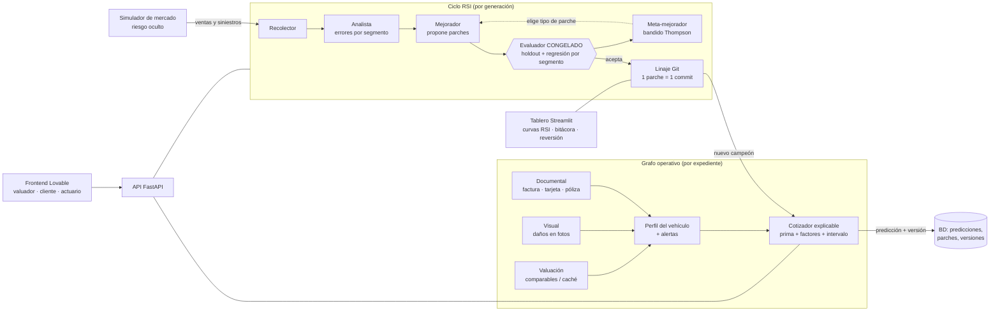

# KAVAK AUTOGUARD AI

> **Todos los datos de este repositorio son SIMULADOS.** No hay autos, personas, pólizas ni siniestros
> reales. Las metas y resultados son de una demo de laboratorio, no tarifas ni sustento actuarial.

MVP que **verifica un auto seminuevo, cotiza su póliza de forma explicable y demuestra que su error de
cotización baja solo** gracias a un ciclo de auto-mejora recursiva (RSI) con evaluador congelado.
Plan completo y pitch: [`KAVAK_AUTOGUARD_AI_Plan_de_trabajo.md`](KAVAK_AUTOGUARD_AI_Plan_de_trabajo.md).
Guion de la demo de 40 s: [`docs/demo.md`](docs/demo.md).

---

## Arquitectura en breve



| Pieza | Dónde | Qué hace |
| --- | --- | --- |
| Agente documental | `autoguard/agents/documental.py` | Extrae VIN, placas, marca, modelo, año y vigencias; cruza documentos con reglas determinísticas y marca discrepancias. |
| Agente visual | `autoguard/agents/visual.py` | Detecta daños `(zona, tipo)` en fotos y estima costo de reacondicionamiento (`data/costos_reparacion.yaml`). |
| Valuación | `autoguard/agents/valuacion.py` | Comparables de mercado vía Tavily/Firecrawl, con caché y fallback determinístico offline. |
| Cotizador | `autoguard/agents/cotizador.py` + `configs/agents/cotizador.yaml` | Prima con factores explicables e intervalo de confianza. Toda la tarifa es configuración versionada. |
| Dictamen de siniestros | `autoguard/agents/dictamen.py` | Dictamen preliminar (fase 2, `POST /dictamen`). |
| Ciclo RSI | `autoguard/rsi/` | Recolector → analista → mejorador → evaluador → linaje → meta-mejorador (LangGraph). |
| Evaluador congelado | `autoguard/evaluator/` | Función objetivo asimétrica `L = 1.5·max(0, c−p) + 1.0·max(0, p−c)`, holdout del 20 %, mejora mínima 1 % y regresión máxima de 5 % por segmento. El RSI **no** puede escribir aquí. |
| Simulador | `autoguard/sim/market.py` | Mercado con función de riesgo oculta; produce ventas y costos reales. |
| API | `autoguard/api/` | FastAPI: expedientes, cotización, outcomes, disparo del RSI, aprobación de parches, versiones y reversión. |
| Tablero RSI | `dashboard/` | Streamlit: curvas de las 3 variantes, regret acumulado (área sombreada), bitácora de parches, bandido, linaje y reversión; modo demo de 40 s. |
| Frontend | Lovable (repo aparte) | Expediente, cotización y aprobación de parches. Prompt en [`docs/lovable_prompt.md`](docs/lovable_prompt.md). |

**Principios:** el LLM propone y el código certifica (comparar VIN, calcular primas, medir errores y
evaluar parches es código determinístico); todo agente es configuración YAML versionada en Git (un parche
es un commit, revertible); toda predicción guarda la versión exacta del agente que la produjo; solo
variables permitidas (lista blanca, sin atributos sensibles). Auditoría: [`docs/auditoria.md`](docs/auditoria.md).

El experimento compara **tres cotizadores viendo los mismos autos**:

- `estatico`: reglas fijas, nunca cambia.
- `parametros`: solo ajusta factores numéricos (un único tipo de parche).
- `rsi`: RSI completo; el meta-mejorador aprende qué tipos de parche funcionan.

---

## Instalación

Requiere Python ≥ 3.11 (probado con 3.12) y Git.

```bash
git clone <url-del-repo> && cd OdysseyHandle-IA
python -m venv .venv                       # o: uv venv .venv --python 3.12
source .venv/bin/activate                  # Windows: .venv\Scripts\activate
pip install -e '.[dev]'                    # o: uv pip install -e '.[dev]'
cp .env.example .env                       # opcional: todo funciona sin llaves
```

En Windows el intérprete es `.venv\Scripts\python.exe` (en lugar de `.venv/bin/python`) y los
ejecutables quedan en `.venv\Scripts\` (`streamlit.exe`, `uvicorn.exe`).

**Sin llaves todo funciona en modo mock**: el LLM responde de forma determinística y la valuación usa
caché/fallback offline. `import autoguard` carga `.env` automáticamente; una variable ya exportada en el
shell gana sobre `.env`. Variables relevantes (todas documentadas en [`.env.example`](.env.example)):

| Variable | Default | Para qué |
| --- | --- | --- |
| `ANTHROPIC_API_KEY` | vacía | Vacía ⇒ LLM mock. |
| `LLM_PROVIDER` | `auto` | `mock` fuerza respuestas determinísticas aunque haya llave (recomendado para la demo). |
| `LLM_CACHE` | `0` | `1` guarda respuestas reales en disco (demos reproducibles con llave). |
| `DATABASE_URL` | `sqlite:///var/autoguard.db` | SQLite local; Postgres/Supabase opcional (`db/migrations/001_init.sql`). |
| `AUTOGUARD_API_KEY` | vacía | Si está definida, la API exige `X-API-Key`. Vacía ⇒ sin auth (solo local). |
| `AUTOGUARD_CORS_ORIGINS` | `*` | Orígenes permitidos (p. ej. el dominio de Lovable). |
| `AUTOGUARD_RUNS_DIR` | `var/runs` | Corridas del RSI que leen la API y el tablero. |
| `TAVILY_API_KEY` / `FIRECRAWL_API_KEY` | vacías | Comparables web; vacías ⇒ caché/fallback. `VALUACION_OFFLINE=1` nunca sale a la red. |

---

## Cómo correr

Todos los comandos desde la raíz del repo, con el venv activado (o anteponiendo `.venv/bin/`).

### Demo completa en un paso

```bash
bash scripts/demo.sh            # prepara la corrida seed 42 (mock) e imprime cómo levantar todo
bash scripts/demo.sh --start    # además levanta API (:8000) y tablero (:8501) en segundo plano
bash scripts/demo.sh --stop     # detiene lo que levantó --start
```

Detalle y guion segundo a segundo en [`docs/demo.md`](docs/demo.md).

### Tests

```bash
python -m pytest
```

La suite fuerza `LLM_PROVIDER=mock`, ignora `.env` (`AUTOGUARD_NO_DOTENV=1`) y **nunca** llama a la red.

### Experimento RSI (3 variantes)

```bash
LLM_PROVIDER=mock python -m autoguard.rsi.loop --seed 42
# flags: --seed 42 --batches 60 --batch-size 200 --k 3 --output-dir var/runs/<nombre>
```

- `--batches` lotes de `--batch-size` autos; cada `--k` lotes es una generación RSI (60 × 200 / 3 ⇒
  12,000 pólizas por variante y 20 generaciones).
- Escribe en `var/runs/<run_id>/` (o `--output-dir`, que **no** debe existir): `curve.csv`,
  `summary.json`, `patches.jsonl`, `versions.jsonl`, `meta.jsonl` y un repo Git de configuración por
  variante en `configs/<variante>/`.
- `summary.json` trae `regret` por variante, `mejora_rsi`, `convergencia_polizas` y `gate2`.

### API (FastAPI)

```bash
uvicorn autoguard.api.main:app --reload --port 8000
# Swagger: http://localhost:8000/docs · salud: GET /health
```

| Endpoint | Para qué |
| --- | --- |
| `POST /expedientes` | Multipart: `docs` (factura, tarjeta, póliza), `fotos`, `datos` (JSON). Devuelve perfil, alertas, valuación y cotización explicable. |
| `POST /quote` | Cotiza un `VehicleProfile`. |
| `GET /vehicles/{id}` | Expediente guardado. |
| `POST /outcomes` | Ingesta de resultados reales (ventas/siniestros). |
| `POST /rsi/run` · `GET /rsi/run/{job_id}` | Dispara el experimento en segundo plano y consulta su estado. |
| `GET /runs/latest` | Resumen de la última corrida (`?incluir_curva=true`). |
| `GET /patches` · `POST /patches/{id}/approve` · `POST /patches/{id}/reject` | Bitácora y aprobación humana. |
| `GET /versions/{agent}` · `POST /versions/{agent}/revert/{sha}` | Linaje y reversión del campeón. |
| `POST /dictamen` | Dictamen preliminar de siniestro. |

Ejemplo con los archivos de muestra (SIMULADOS):

```bash
curl -s -X POST http://localhost:8000/expedientes \
  -F docs=@data/samples/docs/EXP-001-FAC.png \
  -F docs=@data/samples/docs/EXP-001-TC.png \
  -F docs=@data/samples/docs/EXP-001-POL.png \
  -F fotos=@data/samples/fotos/FOTO-001.png \
  -F 'datos={"kilometraje": 45000, "uso": "particular"}'
```

### Tablero RSI (Streamlit)

```bash
streamlit run dashboard/app.py --server.port 8501
```

Lee las corridas de `var/runs/` (o `AUTOGUARD_RUNS_DIR`) cada vez que se recarga. Muestra pérdida por
lote y regret acumulado de las 3 variantes, la bitácora de parches con métricas antes/después, el bandido
del meta-mejorador y la pestaña **Linaje y reversión**. El **modo demo** (barra lateral → *Activar
reproducción* → ▶ Play) recorre las generaciones en unos 40 s. Si no hay corridas, cae a
`data/demo_run/` (plan B). Más detalle en [`dashboard/README.md`](dashboard/README.md).

### Dashboard de progreso del equipo

```bash
streamlit run tools/progreso/app.py --server.port 8502
```

Muestra el estado de coordinación de las sesiones (lee `bash scripts/tasks.sh tsv`; necesita acceso Git
al remoto). Ver [`tools/progreso/README.md`](tools/progreso/README.md).

### Otros

```bash
python -m autoguard.agents.documental --eval    # precisión de extracción en mock
python -m autoguard.agents.visual --eval        # recall de daños en mock
python scripts/eval_llm.py                      # medición con LLM real (requiere ANTHROPIC_API_KEY)
```

---

## Resultados del experimento (semillas 42, 1, 7, 123)

> **BORRADOR.** Los números finales los pone T-23. Todo lo marcado `{{T23_...}}` está pendiente.

Regret acumulado (MXN, menor es mejor) con `--batches 60 --batch-size 200 --k 3`:

| Semilla | `estatico` | `parametros` | `rsi` | Mejora RSI vs estático |
| --- | --- | --- | --- | --- |
| 42 | {{T23_REGRET_42_ESTATICO}} | {{T23_REGRET_42_PARAMETROS}} | {{T23_REGRET_42_RSI}} | {{T23_MEJORA_42}} |
| 1 | {{T23_REGRET_1_ESTATICO}} | {{T23_REGRET_1_PARAMETROS}} | {{T23_REGRET_1_RSI}} | {{T23_MEJORA_1}} |
| 7 | {{T23_REGRET_7_ESTATICO}} | {{T23_REGRET_7_PARAMETROS}} | {{T23_REGRET_7_RSI}} | {{T23_MEJORA_7}} |
| 123 | {{T23_REGRET_123_ESTATICO}} | {{T23_REGRET_123_PARAMETROS}} | {{T23_REGRET_123_RSI}} | {{T23_MEJORA_123}} |
| **Media** | | | | **{{T23_MEJORA_MEDIA}}** |

Pólizas hasta convergencia (ventana de 3 lotes dentro del 5 % de la pérdida final): `rsi`
{{T23_CONVERGENCIA_RSI}} vs `parametros` {{T23_CONVERGENCIA_PARAMETROS}}.

### Gate 2: no alcanzado (contexto honesto)

El plan fijó como meta de diseño que el RSI tuviera **al menos 40 % menos regret** que el estático y
convergiera en menos pólizas que la variante de solo parámetros. Al medir el techo del problema
simulado se encontró que esa meta queda en el límite de lo alcanzable:

- Un **oráculo con conocimiento perfecto** de la función de riesgo oculta solo logra **~44 %** menos
  regret (43.7 %–44.8 % según la semilla): el resto es ruido irreducible del costo real.
- Un **aprendiz ideal** que ya conoce la estructura verdadera y solo estima sus parámetros con los datos
  disponibles logra **39 %–41 %**.
- La línea base del RSI en T-13 logró **−4.3 %**. Resultados preliminares de T-23:
  {{T23_PRELIMINAR}} (borrador: −27.4 % en seed 42 y −25.6 % en seed 1).
- Resultado final de T-23: {{T23_RESUMEN_GATE2}}.

Es decir, el 40 % fijo exige prácticamente el desempeño de un aprendiz que ya conoce la respuesta. Lo
reportamos tal cual en lugar de ajustar la meta o el evaluador (que están congelados por diseño).

---

## Limitaciones honestas

- **Datos simulados.** Documentos, fotos, mercado y siniestros son sintéticos; el simulador tiene una
  función de riesgo oculta diseñada por nosotros. Nada aquí es una tarifa real ni sustento ante la CNSF.
- **Gate 2 no alcanzado** (ver arriba): el RSI reduce el regret frente al estático, pero no llega al 40 %.
- **LLM no medido con llave real.** En la suite y la demo el LLM corre en mock (100 % en `--eval` por
  construcción). El script de medición real existe (`scripts/eval_llm.py`, ver
  [`docs/eval_llm.md`](docs/eval_llm.md)), pero las metas de ≥ 90 % de extracción y ≥ 80 % de recall de
  daños no se han medido con una llave real.
- **Sandbox sin Docker.** Los parches de nivel código se ejecutan en `autoguard/evaluator/sandbox.py`; sin
  Docker usa un fallback `subprocess` que **no** es frontera de seguridad (sin aislamiento de red real).
  Para demos que ejecuten parches de código, usar Docker o deshabilitar ese nivel.
- **API sin auth por defecto.** Si `AUTOGUARD_API_KEY` está vacía, la API no exige llave (solo para uso
  local). La API no guarda los archivos subidos.
- **Persistencia opcional.** Las curvas del experimento viven en disco (`var/runs/`); la BD solo guarda
  parches y versiones si hay `DATABASE_URL`.
- **Frontend en repo aparte.** El frontend de Lovable no vive en este repositorio.

---

## Estructura

```
autoguard/        paquete: agents/, rsi/, evaluator/, sim/, api/, db/, llm.py, contracts.py
configs/agents/   configuración versionada del cotizador (YAML)
dashboard/        tablero RSI (Streamlit)
tools/progreso/   tablero de progreso del equipo
data/             muestras SIMULADAS (docs, fotos), caché de comparables, costos de reparación
db/migrations/    esquema SQL (8 tablas)
docs/             demo, auditoría, evaluación LLM, prompt de Lovable
scripts/          demo.sh, eval_llm.py, tasks.sh (coordinación)
tests/            suite pytest (modo mock, sin red)
```

Protocolo de trabajo del equipo de agentes: [`AGENTS.md`](AGENTS.md) y [`TASKS.md`](TASKS.md).
